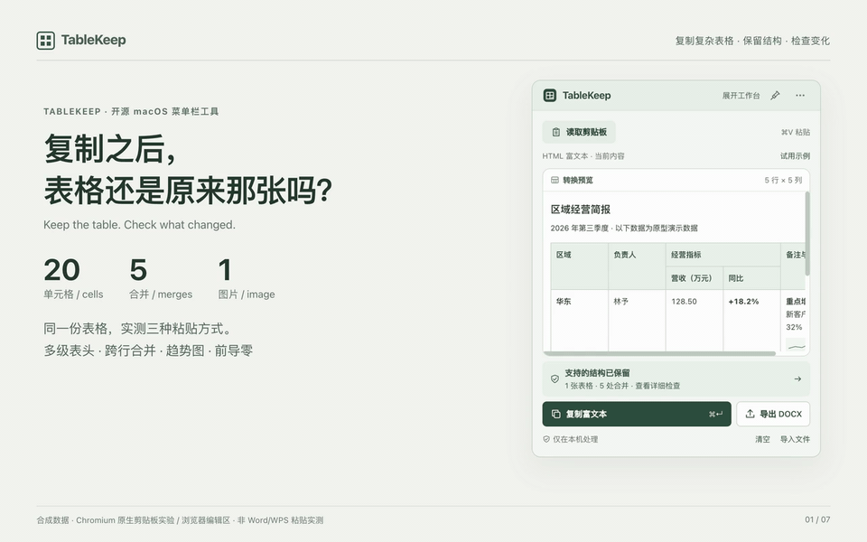

# 可复现的粘贴对比演示

[37 秒 MP4 演示](https://github.com/liushuai-beep/tablekeep/releases/download/v0.3.1/TableKeep-demo-zh-CN.mp4) · [源网页](docs/demo/source.html) · [原始实验数据](docs/demo/evidence.json) · [导出的 DOCX](docs/demo/TableKeep-demo.docx)



## 本次真正比较了什么

同一份合成网页表格，经 macOS 系统剪贴板粘贴进 Chromium 的可编辑区域。源表格包含 20 个单元格、5 处合并和 1 张内嵌图片。

| 路径 | 表格 | 单元格 | 合并 | 图片 | 观察 |
| --- | ---: | ---: | ---: | ---: | --- |
| 默认富文本粘贴 | 1 | 20 | 5 | 1 | 本例支持的内容与结构保留，检查未发现变化 |
| 匹配样式粘贴 | 0 | 0 | 0 | 0 | 表格变成文字，图片仅剩替代文字 |
| 经 TableKeep 复制富文本 | 1 | 20 | 5 | 1 | 本例支持的内容与结构保留，检查未发现变化 |

接着在 TableKeep 工作台中**故意**把 `128.50` 改为 `999.99`。应用报告 2 处内容变化（单元格文字、数字序列），复制与 DOCX 导出按钮被禁用；点击恢复后回到 0 处变化，两个操作重新可用。这里不是转换过程自动改错数字，也不是对其他产品的测试。

默认粘贴在本例也保留了表格。TableKeep 的差异是保留支持的结构，并提供额外的内容核对与导出路径；这份演示不支持“直接粘贴必坏”或“任意表格百分之百保真”的说法。

## 演示的形式与边界

- MP4/GIF 是**真实 Electron 渲染器截图的字幕剪辑**，不是连续桌面录屏。金额修改通过自动化触发真实界面事件，检查器、按钮状态和恢复行为均来自实际应用。
- 网页复制、默认粘贴、匹配样式粘贴以及 TableKeep 输出复制实际经过系统剪贴板，没有用字符串替换来伪造粘贴结果。
- 实验结束后恢复原剪贴板；如果发现剪贴板已被其他程序改写，则保留新的内容。原剪贴板数据不写入文件。
- 文件读写、设置与窗口切换使用演示宿主。没有在这段演示中操作实际菜单栏图标，也没有证明最终 Office 排版。
- **这次没有在 Word、WPS 或 Pages 中执行粘贴。** 之前 Pages 打开 DOCX 的观察另见 [实验记录](EXPERIMENTS.zh-CN.md)。字体、页面排版和原生可编辑公式不属于本次保真结论。
- 测试设备为 macOS / Apple Silicon；准确 Electron/Chromium 版本见原始实验数据。当前 UI 为中文，下载包尚未 Apple 公证。

## 自己复现

```sh
npm ci
npm run demo:capture
```

需要 macOS 图形会话。此命令会临时使用系统剪贴板；请在没有其他复制任务时运行。它输出截图、合成源网页、DOCX 和 `evidence.json`，用断言核实粘贴结果及检查行为。`npm test` 另有“表格变纯文本、节点 ID 被其他类型复用”的回归用例，防止检查器崩溃。

字幕分镜同样提供源代码。安装 FFmpeg 后可由上述截图重新生成视频：

```sh
npm run demo:render
cd docs/demo/frames
ffmpeg -f concat -safe 0 -i playlist.txt -t 37 -vf 'fps=24,format=yuv420p' -c:v libx264 -crf 20 -movflags +faststart TableKeep-demo-zh-CN.mp4
```

若要测试自己的文档软件：打开 `docs/demo/source.html`，选中正文复制，分别直接粘贴与经 TableKeep 复制后粘贴到**两份空白文档**，核对合并、图像、换行、金额与 `000182`。请提交脱敏结果，并说明源浏览器、目标软件与版本。
