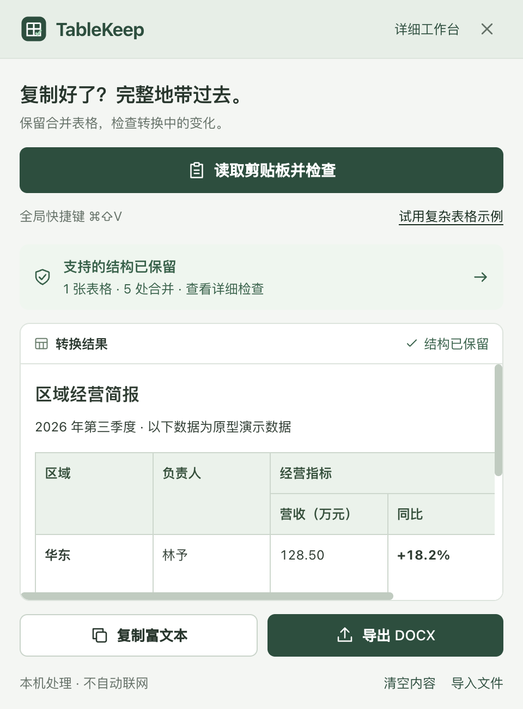
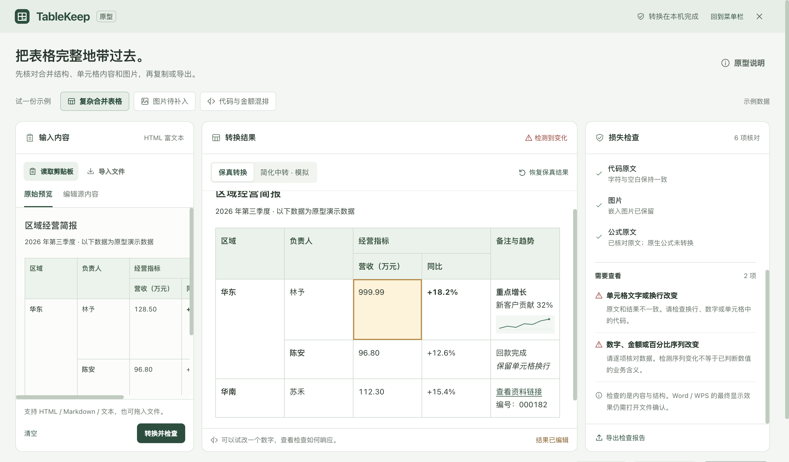

# TableKeep

**Keep merged tables intact. See what changed before you paste.**

A local macOS **menu bar app** for converting copied HTML and Markdown into office-friendly rich text and DOCX, with an explicit conversion-loss report. Click the table icon at the top of your screen, paste, check, and carry on.

[Download for Apple Silicon Mac](https://github.com/liushuai-beep/tablekeep/releases/latest) · [中文说明](README.zh-CN.md) · [Report a bug](https://github.com/liushuai-beep/tablekeep/issues)



## Why TableKeep?

A table can look reasonable after conversion while its merged header, leading zeros, empty cells, image, or amount has changed. TableKeep builds a structured representation of the input, renders the output, parses it again, and compares the two. Its findings distinguish detected changes from unsupported content.

This is an early working prototype. The check covers recognized content and supported styles; it cannot prove fidelity for every source or predict Word/WPS layout.

## What works

- **Menu bar first:** a compact popover, `⌘⇧V` to open and read, Escape or outside click to dismiss. No Dock icon. A detailed workbench expands the same content when you need it.
- **Merged tables:** row spans, column spans, nested tables, empty cells, leading zeros, line breaks, and embedded PNG/JPEG/GIF images.
- **Loss inspection:** compares cell placement, spans, text, numeric sequences, supported emphasis, links, code, images, and formula source. Click a finding to locate it; restore from the input when needed.
- **Native actions:** explicit clipboard read, rich-text copy, local image replacement, file import, and DOCX/HTML/JSON report export.
- **Local processing:** no account, clipboard polling, paste history, telemetry, or automatic remote-image downloads. Conversion runs on your machine.



## Try it

1. Download the macOS arm64 ZIP from [Releases](https://github.com/liushuai-beep/tablekeep/releases).
2. Extract it and move `TableKeep.app` to Applications. Launch it and click its table icon in the menu bar.
3. Copy a table from your source app. Click **读取剪贴板并检查**, or press `⌘⇧V` if that shortcut is available.
4. Inspect the result, then copy rich text or export DOCX. Open the exported file in your office app to confirm its actual layout.

The UI is currently in Chinese. **试用复杂表格示例** loads synthetic demo data. **详细工作台** expands the comparison and findings. Right-click the menu bar icon to quit. Closing the panel keeps the app running.

The preview binary is locally ad-hoc signed, **not Developer ID signed or notarized**. macOS may block its first launch; review the source and use the system's Privacy & Security controls if you trust it, or build it locally. Only Apple Silicon macOS is packaged and tested in this release. The shortcut is registered only if another app has not claimed it; the read button always remains available.

## Limits, stated plainly

- Input: rich HTML, basic Markdown, and text; local `.html`, `.htm`, `.md`, `.markdown`, and `.txt` files. No direct DOCX/XLSX/PDF import or OCR.
- Formula **source text** is retained and flagged; native editable Word equations are not generated.
- External images are placeholders until supplied locally. SVG is reported as unsupported, rather than silently dropped.
- Supported emphasis includes bold, italic, underline, super/subscript, code, and links. Arbitrary CSS, fonts, borders, and page geometry are outside the fidelity guarantee.
- Limits: 200 rows, 40 columns, 180,000 input characters; local replacement images up to 10 MB.
- The workbench's **简化中转 · 模拟** deliberately damages content to demonstrate detection. It is not a benchmark of PasteMD or any other product.
- Checks compare supported input structure with the in-app result. They do not independently verify the final clipboard consumer or Word/WPS renderer. Detected loss blocks copying/exporting that result until restored.

## Develop

Requires macOS and Node.js 22.12+.

```sh
npm ci
npm start
npm test
npm run package:mac
```

The first Electron run may download its runtime. Packaging writes `../TableKeep-build/TableKeep-darwin-arm64/TableKeep.app` and applies a local ad-hoc signature. `npm test` runs 12 regression checks inside Electron, including span preservation, deliberate degradation, actual number edits, input sanitization, and DOCX ZIP output. GitHub Actions runs the checks and packages the app; the published artifact does not include development dependencies.

## How it fits together

| File | Responsibility |
| --- | --- |
| `main.cjs`, `preload.cjs` | Tray, window lifecycle, explicit clipboard/file actions, isolated IPC |
| `engine.js` | Parsing, intermediate structure, rendering, loss inspection |
| `docx.js` | ZIP/OOXML output with `gridSpan`, `vMerge`, and embedded images |
| `app.js`, `index.html` | Shared in-memory popover/workbench interaction |
| `styles.css`, `menubar.css` | Detailed and compact layouts |
| `samples.js` | Clearly labeled synthetic test content |

The conversion core and OOXML writer are implemented in this project. Electron provides the desktop shell. The renderer has no Node.js access, uses context isolation and sandboxing, and denies outbound network requests. No accessibility permission or screen recording is needed for the conversion workflow.

## Contribute

Useful next steps: anonymized real-world table fixtures, Word/WPS compatibility checks, native equation export, English UI, and additional desktop platforms. See [CONTRIBUTING.md](CONTRIBUTING.md). Please redact personal information before sharing sample clipboard content.

## License

[MIT](LICENSE). Electron and bundled third-party components retain their respective licenses.
